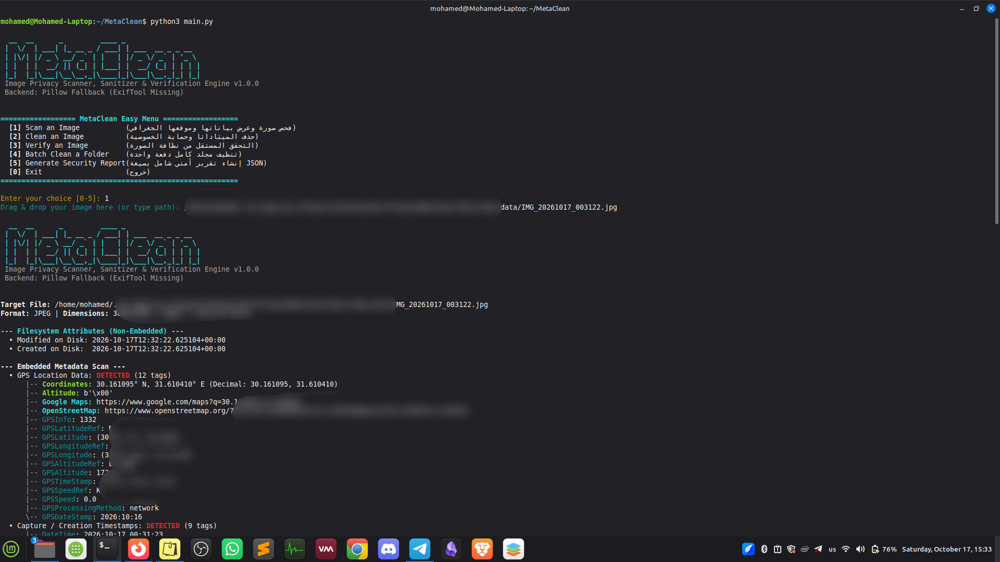
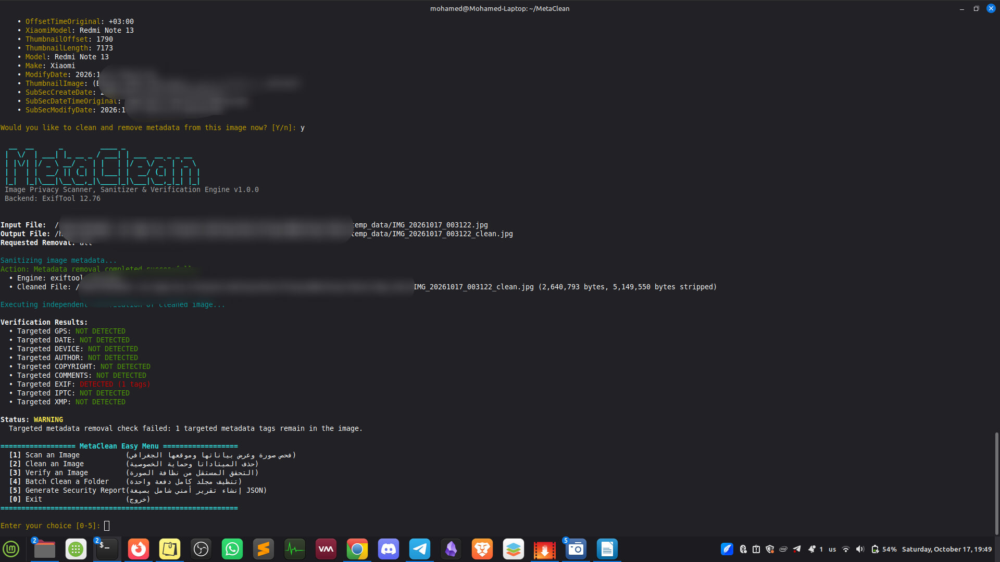

# MetaClean

### Image Metadata Intelligence, Privacy Analysis & Sanitization Platform

MetaClean is a command-line platform for exhaustively inspecting image metadata, explaining its privacy impact, removing it safely, and independently verifying that the removal worked.

- **Project type:** Cybersecurity graduation project
- **Target environment:** Linux Mint / Ubuntu (also runs on POSIX and Windows)
- **Language:** Python 3.10+
- **Metadata engine:** ExifTool (recommended) with a Pillow fallback
- **License:** MIT

## Screenshots

### 1. Metadata Scan


### 2. Cleaning and Verification


---

## Table of Contents

1. [Overview](#1-overview)
2. [What is new in 2.0](#2-what-is-new-in-20)
3. [Features](#3-features)
4. [Requirements](#4-requirements)
5. [Installation](#5-installation)
6. [Quick Start](#6-quick-start)
7. [Commands](#7-commands)
8. [Scan modes](#8-scan-modes)
9. [Sanitization profiles](#9-sanitization-profiles)
10. [Verification outcomes](#10-verification-outcomes)
11. [Batch processing](#11-batch-processing)
12. [Reports and redaction](#12-reports-and-redaction)
13. [Privacy taxonomy and scoring](#13-privacy-taxonomy-and-scoring)
14. [Metadata categories](#14-metadata-categories)
15. [Exit codes](#15-exit-codes)
16. [Security and safety design](#16-security-and-safety-design)
17. [Supported formats](#17-supported-formats)
18. [Running tests](#18-running-tests)
19. [Limitations](#19-limitations)
20. [Project structure](#20-project-structure)
21. [Documentation](#21-documentation)
22. [License](#22-license)

---

## 1. Overview

Images carry more than pixels. Embedded metadata can include GPS coordinates, exact capture times, camera and lens identities, serial numbers, author names, contact details, editing history, embedded thumbnails, and vendor-specific MakerNotes. Publishing such a file can expose a home address, a workplace, a daily routine, or the device that produced the image.

MetaClean helps users:

1. **Scan** an image and enumerate metadata exhaustively across EXIF, GPS, IPTC, XMP, MakerNotes, ICC profiles, thumbnails, and the container itself.
2. **Analyze** each finding against a five-level privacy taxonomy with a transparent, explainable score.
3. **Sanitize** the file using a semantic profile (location, personal, basic, maximum, or custom) while always preserving the original.
4. **Verify** the output independently and report an explicit outcome.
5. **Export** JSON, CSV, or HTML reports, redacted by default.

> **Important:** Metadata availability depends on the image, its source, and the software used to create or edit it. A scan cannot prove that every possible form of hidden information has been detected.

## 2. What is new in 2.0

- **Exhaustive extraction:** structured XMP/IPTC parsing, raw numeric values, MakerNotes families, embedded thumbnails, and container structure.
- **Provenance for every tag:** group, family, category, raw value, human-readable value, inferred type, extraction status, and derived flag.
- **Deep file analysis:** container vs. extension mismatch, MIME type, bit depth, colour model, frames, ICC profiles, trailing data after the end marker, and timestamp inconsistencies. Findings are classified as `CONFIRMED`, `SUSPICIOUS`, or `INFORMATIONAL`.
- **Five-level privacy taxonomy:** `INFORMATIONAL`, `LOW`, `MEDIUM`, `HIGH`, `CRITICAL`, with documented weights and caps.
- **Sanitization profiles:** `basic`, `location`, `personal`, `maximum`, and `custom`.
- **Explicit verification outcomes:** `VERIFIED CLEAN`, `PARTIALLY CLEANED`, `SENSITIVE DATA REMAINS`, `VERIFICATION FAILED`.
- **Before/after comparison:** removed, remaining, changed, and newly introduced tags, plus risk-score delta.
- **Professional CLI:** deep/privacy/full modes, `info`, `--verbose`, `--quiet`, `--no-color`, `--format`, redaction controls, and stable exit codes.
- **Batch safety:** scan-only mode, SHA-256 duplicate skipping, symlink refusal by default, output-directory exclusion, and per-file isolation.

## 3. Features

- **Read-only scanning** that never modifies the input file.
- **Independent privacy analysis** with human-readable explanations and recommendations.
- **Non-destructive cleaning** onto a temporary copy that is atomically moved into place.
- **Output validation** before success is reported: the cleaned file must remain a readable image with matching dimensions.
- **Independent verification** that re-opens the output instead of trusting ExifTool's exit code.
- **Batch processing** with error isolation and collision-free destinations.
- **Reports:** JSON audit reports, per-tag CSV exports, and self-contained HTML reports.
- **Redaction by default** in CLI reports; unredacted export is explicit and warns before writing sensitive values.
- **No network access** and no execution of metadata content.

## 4. Requirements

- Python 3.10 or newer
- `pip` and `venv`
- ExifTool (strongly recommended; the Pillow fallback cannot inspect IPTC, XMP, or MakerNotes fully)
- Git, if cloning the repository

## 5. Installation

### Option A: Installer (recommended)

```bash
sudo apt update
sudo apt install -y git python3 python3-pip python3-venv libimage-exiftool-perl

git clone https://github.com/mobadawyx4/MetaClean.git
cd MetaClean
chmod +x install.sh
./install.sh
```

### Option B: Manual installation

```bash
sudo apt install -y python3 python3-pip python3-venv libimage-exiftool-perl
cd ~/MetaClean
python3 -m venv venv
./venv/bin/python -m pip install --upgrade pip
./venv/bin/python -m pip install -r requirements.txt
```

Verify the backend:

```bash
exiftool -ver
./venv/bin/python main.py info
```

### Windows (PowerShell)

```powershell
git clone https://github.com/mobadawyx4/MetaClean.git
cd MetaClean
Set-ExecutionPolicy -Scope Process Bypass
.\install.ps1
.\run.ps1 info
```

## 6. Quick Start

```bash
# 1. Inspect the image
./venv/bin/python main.py scan photo.jpg

# 2. Remove all supported metadata into a new file
./venv/bin/python main.py clean photo.jpg --profile maximum --yes

# 3. Verify the result independently
./venv/bin/python main.py verify photo_clean.jpg --profile maximum --original photo.jpg
```

Running `main.py` with no arguments opens the interactive menu; `main.py photo.jpg` is a shortcut for `scan`.

## 7. Commands

| Command | Purpose |
| --- | --- |
| `scan` | Inspect metadata, privacy risk, and container structure. |
| `clean` | Write a sanitized copy using categories or a profile. |
| `verify` | Independently verify an image or a cleaned output. |
| `batch` | Scan or sanitize a directory of images. |
| `report` | Produce a JSON, CSV, or HTML audit report. |
| `info` | Show version, backend, modes, profiles, categories, and exit codes. |

Global options accepted before or after the subcommand:

```text
-v, --verbose     additional diagnostic detail
-q, --quiet       suppress informational output (errors still go to stderr)
    --no-color    disable ANSI colors
-V, --version     print the version
```

### Scan

```bash
./venv/bin/python main.py scan photo.jpg
./venv/bin/python main.py scan photo.jpg --deep --detailed
./venv/bin/python main.py scan photo.jpg --full --report scan.html --format html
./venv/bin/python main.py scan photo.jpg --fail-on-risk
```

- `--deep` adds structured XMP/IPTC parsing, raw values, and container analysis.
- `--privacy` performs a privacy-focused deep scan.
- `--full` adds embedded-file extraction (`-ee`) and is the slowest mode.
- `--report PATH --format json|html|csv` writes a report.
- `--redact` (default) masks sensitive values; `--no-redact` is explicit and warns.
- `--fail-on-risk` returns exit code `1` when HIGH or CRITICAL risk is detected.

### Clean

```bash
./venv/bin/python main.py clean photo.jpg --profile maximum --yes
./venv/bin/python main.py clean photo.jpg --profile basic --output private.jpg
./venv/bin/python main.py clean photo.jpg --profile custom --remove gps,author --yes
./venv/bin/python main.py clean photo.jpg --remove gps --output no_gps.jpg --yes
```

The original file is never modified. Cleaning writes to a private temporary copy in the destination directory, validates it, and only then replaces the output atomically. Symlinks and same-file outputs are refused.

### Verify

```bash
./venv/bin/python main.py verify photo_clean.jpg --profile maximum
./venv/bin/python main.py verify photo_clean.jpg --original photo.jpg --report verify.json
```

### Report

```bash
./venv/bin/python main.py report photo.jpg --output audit.json
./venv/bin/python main.py report photo.jpg --output audit.html --format html
./venv/bin/python main.py report photo.jpg --output audit.csv --format csv --redact
./venv/bin/python main.py report photo.jpg --output audit.json --cleaned photo_clean.jpg --profile maximum
```

### Info

```bash
./venv/bin/python main.py info
./venv/bin/python main.py info --json
```

## 8. Scan modes

| Mode | Extraction behaviour |
| --- | --- |
| `standard` | Classic extraction: all named tags plus unknown tags. |
| `deep` | Standard extraction plus structured XMP/IPTC parsing, raw numeric values, and container analysis. |
| `privacy` | Deep extraction organised around privacy reporting. |
| `full` | Deep extraction plus embedded-file extraction (`-ee`); most exhaustive and slowest. |

## 9. Sanitization profiles

| Profile | Removes | Typical use |
| --- | --- | --- |
| `basic` | GPS/textual location, author/creator, comments, copyright | Everyday sharing |
| `location` | GPS and textual location (city, state, country, sublocation) | Location privacy while preserving photo settings |
| `personal` | Author, copyright, comments, unique identifiers | Anonymous publishing with device data retained |
| `maximum` | All supported metadata (EXIF, GPS, IPTC, XMP, MakerNotes, thumbnails, software) | Highest-assurance release |
| `custom` | Exactly the categories supplied with `--remove` | Targeted workflows |

Container, colour-space, and orientation structure required for correct rendering is preserved by `maximum`.

Selective categories intentionally overlap in a few places so that one privacy
theme cannot survive under another tag name:

- `gps` removes native GPS fields and textual place names (IPTC City/State/
  Country, XMP Location/LocationCreated/LocationShown, Keys/drone/Darwin Core
  coordinates). It does **not** remove `SubjectLocation`/`SubjectArea`, which
  are image-relative composition data.
- `date` uses `-*Date*=` plus `-*Timestamp*=`/`-*Timecode*=` and therefore also
  removes GPS and vendor date/timestamp fields. Time fields are enumerated
  rather than using `-*Time*=`, so `ExposureTime` and shutter-release lag
  settings are retained.
- `device` uses `-*Software*=` and therefore also removes editing-software
  identity. `Software`/`ProcessingSoftware` are detected as `software`.
  `-*Model=` only matches names ending in `Model`, so GeoTIFF `ModelTiePoint`,
  `ModelTransform`, and `ModelPixelScale` survive.
- `author` and `copyright` use `-*Creator*=`, `-*Owner*=`, and `-*Rights*=`;
  these intentionally overlap with software identity (`CreatorTool`,
  `CreatorAppID`) and rights-owner fields so a privacy theme cannot survive
  under a different namespace.
- `comments` uses `-*Comment*=`, `-*Description=`, `-*Caption*=`, and
  `-*Keyword*=`; this also removes description-like vendor fields (for example
  `DeviceSettingDescription`, `SeriesDescription`, and hierarchical keywords),
  which is broader than EXIF `ImageDescription` by design.
- `gps` coordinate wildcards (`-*Latitude=`, `-*Longitude=`,
  `-*Coordinates=`) also cover drone, Keys, and Darwin Core geography fields,
  not just the EXIF GPS IFD.
- `maximum` removes every writable metadata block, then restores colour-space
  and orientation tags so rendering is unchanged.
- `tests/test_category_coverage.py` audits every writable tag in ExifTool's
  database against the classifier and the category arguments, not just the
  documented examples.


## 10. Verification outcomes

| Outcome | Meaning | Exit code |
| --- | --- | --- |
| `VERIFIED CLEAN` | No residual sensitive metadata was detected in the inspected structures for the selected profile. | `0` |
| `PARTIALLY CLEANED` | Targeted categories are clean, but residual or unselected sensitive metadata remains. | `1` |
| `SENSITIVE DATA REMAINS` | At least one targeted category still contains detectable metadata. | `2` |
| `VERIFICATION FAILED` | The available backend cannot inspect the relevant structures, or the file is invalid. | `2` |

Legacy statuses (`PASS`, `WARNING`, `INCOMPLETE`, `FAIL`) remain available in reports for compatibility.

> `VERIFIED CLEAN` covers the inspected metadata structures for the selected profile. It does not attest to pixel content, steganography, or any data outside those structures.

## 11. Batch processing

```bash
# Scan only: no files are written
./venv/bin/python main.py batch ./photos --scan-only --format json --report scan.json

# Sanitize with a profile
./venv/bin/python main.py batch ./raw --output-dir ./clean --profile maximum --recursive --yes

# Skip duplicates and cap the run
./venv/bin/python main.py batch ./raw --output-dir ./clean --skip-duplicates --max-files 500 --yes
```

Safety behaviour:

- Symbolic links are skipped unless `--follow-symlinks` is explicitly supplied.
- The output directory is excluded from recursive discovery, so a batch cannot re-ingest its own output.
- `--skip-duplicates` hashes file contents with SHA-256 and skips repeats.
- One corrupted file never aborts the batch.
- The input directory may not equal the output directory.
- Batch summaries are redacted by default: rows use positional labels (`image_001`, …) and omit output paths and notes. `--no-redact` is an explicit, confirmed opt-in.

## 12. Reports and redaction

| Format | Contents |
| --- | --- |
| JSON | Full audit: provenance tags, privacy assessment, file analysis, removal summary, verification and comparison, warnings, limitations, methodology note. |
| CSV | One row per tag with group, category, risk level, type, status, and value. |
| HTML | Self-contained report page with overview stats, sensitive findings, container analysis, cleaning and verification sections. |

- Reports are **redacted by default**, for every format and for both single-image and batch exports. Redaction is an allowlist: only container facts from an explicit structural tag list, tag identity, counts, scores and static explanations are emitted.
- Metadata values, GPS data, absolute paths, filenames (batch rows are labelled `image_001`, …), filesystem timestamps, free-text previews and before/after comparison values are withheld.
- A scrub pass removes any leftover identifier literal plus e-mail addresses, phone numbers and home/temporary-directory paths from free-text fields.
- `--no-redact` exports original values, prints a warning, and asks for confirmation when run on a terminal.
- CSV values are neutralised against spreadsheet formula injection.
- HTML output escapes all metadata-derived values; no external assets or network requests are used.
- JSON export uses an allowlisted encoder for bytes, dates/times, paths, UUIDs, decimals, sets, tuples and enums. Unsupported objects and `NaN`/`Infinity` fail with `JSONEncodingError` rather than being silently stringified.
- Report writes are staged and atomic: a failed export cannot truncate or destroy an existing report.

## 13. Privacy taxonomy and scoring

Each tag is classified into one of five levels:

| Level | Weight per tag | Category cap | Examples |
| --- | --- | --- | --- |
| `CRITICAL` | 35 | 70 | GPS coordinates, direct contact details |
| `HIGH` | 18 | 45 | Author/creator names, serial numbers, unique IDs, embedded previews |
| `MEDIUM` | 7 | 21 | Timestamps, camera make/model, copyright text, comments |
| `LOW` | 2 | 6 | Exposure settings, software fields, generic technical tags |
| `INFORMATIONAL` | 0 | 0 | Dimensions, colour space, container structure, ICC profile |

The overall score is `min(100, sum(capped per-level contributions))`. The report includes the exact arithmetic and the fixed constants used.

**This score is an explanatory heuristic, not a scientifically validated risk metric.** It exists to make the reasoning transparent and reproducible.

## 14. Metadata categories

| Category | Examples |
| --- | --- |
| `gps` | Coordinates, altitude, direction, GPS timestamps, and textual location (city/state/country/sublocation) |
| `date` | Capture, creation, modification, digitization, release, and expiration timestamps |
| `device` | Camera make/model, lens, firmware, serial numbers, host/device IDs |
| `author` | Artist, creator, owner, contact information |
| `copyright` | Copyright notices, rights, usage terms |
| `comments` | Comments, descriptions, titles, headlines, captions, keywords |
| `exif` | Exchangeable Image File Format block |
| `iptc` | IPTC application record |
| `xmp` | XMP packets and structured properties |
| `software` | Software, creator tool, processing history |
| `identifiers` | Document/instance/unique identifiers |
| `thumbnail` | Embedded thumbnails and previews |
| `makernotes` | Vendor-specific MakerNotes |
| `informational` | Structural and colour-management fields |

Detection and removal are kept aligned by `tests/test_category_coverage.py`,
which verifies every documented tag against the classifier and every removal
argument against ExifTool. Read-only preview representations
(`PreviewTIFF`/`PreviewPDF`/`ThumbnailTIFF`) have no writable ExifTool key name;
they are detected as `thumbnail` and removed only by a full clean (`maximum`).

## 15. Exit codes

| Code | Meaning |
| --- | --- |
| `0` | Success / verified clean |
| `1` | Warning / partially cleaned / risk threshold reached |
| `2` | Failure / sensitive data remains / invalid input |
| `3` | Usage error |

## 16. Security and safety design

- **Originals are never modified.** Cleaning operates on a private temporary copy and replaces only the destination.
- **No shell interpolation.** All external commands use argument lists with `--` before paths.
- **No trust in names.** A file's extension and MIME type are verified against magic bytes and the decoded container.
- **No execution of metadata.** Values are treated as data, escaped on output, and never evaluated.
- **Symlinks are refused, not followed.** Scan/clean/verify inputs, clean destinations, batch input/output directories, and report outputs may not be a symbolic link in their final path component. Dangling links are refused too. Batch `--follow-symlinks` is the only explicit opt-in, and it operates on the resolved target, never through the link.
- **Alias-safe destinations.** Identical paths, `..`/relative aliases, hardlinks, and same device/inode outputs are refused, so a "new" output name cannot silently overwrite the input or another alias.
- **Validate before replace.** The destination is untouched until the staged file is a readable image, non-empty, and dimension-compatible. ExifTool failure, truncated output, dimension mismatch, a symlink swap, or a changed destination leaves existing content intact.
- **Identity-checked replacement.** Input, destination, output directory, and temporary file identities are re-checked immediately before the atomic `os.replace`; POSIX builds use `O_NOFOLLOW` for every read and copy.
- **Cleanup is scoped.** Temporary cleanup removes only the private file this run created, never a file that was moved into the temp name.
- **Verification is independent.** Success is never inferred from a zero exit code.
- **Batch isolation.** Symlinks are opt-in, outputs are excluded, duplicates are optional, and failures are per-file.
- **Redaction-first reporting.** Every export is allowlist-redacted unless `redact=False`/`--no-redact` is supplied explicitly; unknown fields are withheld rather than printed.

See [`docs/THREAT_MODEL.md`](docs/THREAT_MODEL.md) for the full threat model.

## 17. Supported formats

- JPEG (`.jpg`, `.jpeg`)
- PNG (`.png`)
- WebP (`.webp`)
- TIFF (`.tif`, `.tiff`)
- BMP (`.bmp`)

Extraction, removal, and verification capabilities vary by format and by whether ExifTool is available.

## 18. Running tests

```bash
./venv/bin/python -m pytest tests -v
```

Run a single module:

```bash
./venv/bin/python -m pytest tests/test_scanner.py -v
./venv/bin/python -m pytest tests/test_profiles.py -v
./venv/bin/python -m pytest tests/test_file_analyzer.py -v
./venv/bin/python -m pytest tests/test_cli.py -v
```

All tests use synthetic images generated during the test run; no sample photo or personal data is required.

## 19. Limitations

- MetaClean focuses on supported image metadata structures (EXIF, GPS, IPTC, XMP, MakerNotes, ICC, container data).
- It does not detect steganography or arbitrary information encoded in pixel values.
- The Pillow fallback cannot fully inspect IPTC, XMP, or MakerNotes; verification reports `VERIFICATION FAILED` rather than claiming a clean result.
- Removing metadata does not remove sensitive content that is visibly present in the image.
- Redaction withholds metadata values, paths and filenames, but it cannot remove personal information that is written into pixel content, and an unredacted report intentionally contains every original value.
- Privacy scores are heuristics, not validated risk measurements.
- ExifTool support for exotic vendor MakerNotes varies by camera model.
- Symlink protection is strongest on POSIX systems with `O_NOFOLLOW`. On platforms without it, the final-component check is lstat-based and a narrow time-of-check/time-of-use window remains; see [Methodology §5.4](docs/METHODOLOGY.md#54-path-and-symlink-policy-f-06).
- Intermediate directory symlinks (for example a symlinked `/tmp` or home directory) are resolved once so the tool works on ordinary systems. Destructive replacement is still guarded by final-component and identity checks.

## 20. Project structure

```text
MetaClean/
├── main.py                     CLI entry point and interactive menu
├── config.py                   Constants, categories, scan modes, structural allowlist
├── requirements.txt
├── install.sh / install.ps1
├── run.sh / run.ps1
├── modules/
│   ├── exiftool_backend.py     Safe ExifTool invocation and parsing
│   ├── image_validator.py      Magic-byte and decode validation
│   ├── metadata_scanner.py     Exhaustive extraction and categorization
│   ├── privacy_analyzer.py     Five-level taxonomy and scoring
│   ├── file_analyzer.py        Container and consistency analysis
│   ├── sanitizer_profiles.py   Named sanitization profiles
│   ├── metadata_remover.py     Non-destructive cleaning engine
│   ├── comparison.py           Before/after metadata diff
│   ├── metadata_verifier.py    Independent verification and outcomes
│   ├── report_generator.py     JSON, CSV, HTML reports
│   └── batch_processor.py      Batch orchestration and safety
├── tests/
└── docs/
    ├── ARCHITECTURE.md
    ├── THREAT_MODEL.md
    ├── METHODOLOGY.md
    └── DEVELOPMENT_PLAN.md
```

## 21. Documentation

- [`docs/ARCHITECTURE.md`](docs/ARCHITECTURE.md) — components, data flow, and design decisions.
- [`docs/THREAT_MODEL.md`](docs/THREAT_MODEL.md) — assets, adversaries, and mitigations.
- [`docs/METHODOLOGY.md`](docs/METHODOLOGY.md) — extraction, taxonomy, scoring, and verification methodology.
- [`docs/DEVELOPMENT_PLAN.md`](docs/DEVELOPMENT_PLAN.md) — phased delivery record and future work.

## 22. License

MetaClean is released under the MIT License. See the [`LICENSE`](LICENSE) file for the license text.
